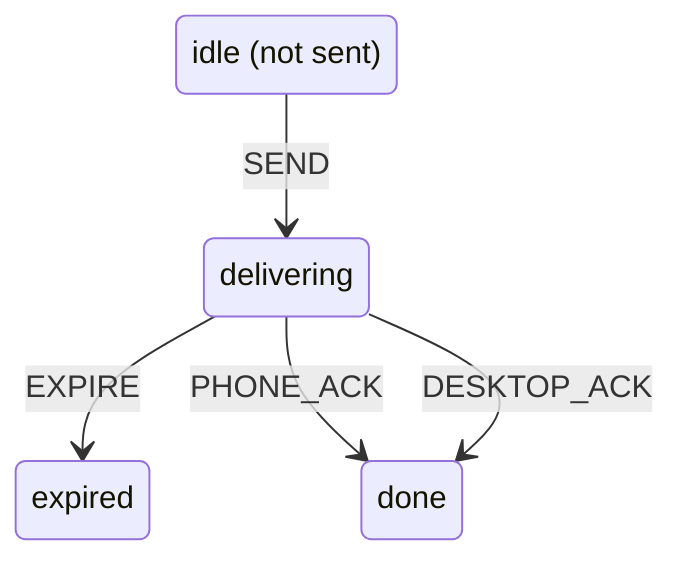

# 状態機械の「悪い状態」の検査は、TLA+ と TLC を入れずに、アプリの言語での全列挙で書ける

## TL;DR

- 状態機械の「悪い状態」と行き止まりの検査は、TLA+ と TLC を入れずに、XState の `xstate/graph` での全列挙で書けた。
- 欠陥を2つ入れた題材は59状態で、両方の欠陥を最短の手順つきで見つけた。直した題材は49状態で、発見は0件だった。
- モデルから作った経路で実装を動かすときは、状態ごとの最短経路では欠陥を拾えず、遷移ごとの経路で拾えた。
- 「いつか必ず起こる」性質は対象外である。確かめたのは自作の題材1つである（2026-11-16）。

## 結論

状態機械について「ある状態が規則を破る」「行き止まりがある」を確かめる用途では、TLA+ と TLC の代わりに、XState で状態機械を書き、`xstate/graph` で到達できる状態を全部たどる。足りない検査は、約40行の補助コードで書ける。Java は要らない。

モデルから作った経路で実装を試すときは、状態ごとの最短経路ではなく、遷移ごとの経路を使う。

「いつか必ず起こる」という性質は、この形の対象外とする。その性質が要るときに、TLA+ と TLC、または FizzBee を検討する。

この知見は題材での検証だけで、`~/.claude` の設定にも、手元の repo にも入れていない。

TLA+ と TLC の役割と、XState での対応は次のとおり。

| TLA+ と TLC の役割 | XState での対応 | 確かめた結果 |
| --- | --- | --- |
| モデルを書く（TLA+） | `createMachine` の定義。そのまま実行できるコードでもある | 約60行で、複数のクライアントに届く通知を書けた |
| 到達できる状態を全部たどる（TLC） | `getShortestPaths` と `getAdjacencyMap` | クライアント5つで 6,249 状態を 267 ミリ秒でたどった |
| 規則を破る状態を見つける（TLC） | 組み込みに無い。たどった各状態に述語を当てる | 18行で書けた |
| 行き止まりを見つける（TLC） | 組み込みに無い。出る遷移が無く、終了でもない状態を拾う | 上の18行に含む |
| 破るまでの最短の手順を出す（TLC） | `getShortestPaths` が返す経路 | 欠陥2つについて、2手と3手の経路が出た |
| 状態遷移図を描く（pstack の `statechart`） | 隣接マップから Mermaid を組み立てる | 16行で書けた |
| 「いつか必ず起こる」を確かめる（TLC） | 無い | 試していない |

## 採用した理由

Java とモデル検査器を入れる前に、手元の言語と道具で届く範囲を確かめられた。

| できるようになったこと | 観察 |
| --- | --- |
| 規則を破る状態と、そこへの最短の手順を得る | 欠陥を2つ入れたモデルは 59 状態で、「通知を同じ端末に2回表示する」が3手、「行き止まり」が2手で見つかった。直したモデルは 49 状態で、発見は0件だった |
| 複数の主体の事象の割り込み順をたどる | システム全体を1つの機械として書くと、各クライアントの切断、再接続、確認がどの順で起きる場合もたどられた。状態数はクライアント1つにつき5倍になった |
| 実装がモデルどおりかを、経路で試す | 状態機械を使わない手書きの実装に欠陥を入れ、モデルから作った経路で動かした。遷移ごとの経路 85 本のうち 10 本が落ちた。欠陥を直すと 0 本になった |
| 図を、検査と同じデータから描く | 隣接マップから Mermaid の状態遷移図を出力した。ラベルを決める関数で、図の粒度を選べる |

### skill にする場合の形（未採用）

この節は設計の案で、作っても試してもいない。[pstack-formal-verification.md](../sources/pstack-formal-verification.md) の2つの skill を、Java を使わない形に置き換える想定である。

| 項目 | 案 |
| --- | --- |
| 入力 | 対象のサブシステム。`sweep` の `state` lens が挙げた暗黙の状態機械を出発点にする |
| 手順1 | 守るべき規則を、平文で1文ずつ書き、人と合意する |
| 手順2 | サブシステムを XState の機械として書く。状態と事象の名前は、コードの名前から取る |
| 手順3 | 全状態で規則と行き止まりを検査し、破る状態への最短の手順を出す |
| 手順4 | 規則ごとに、モデルを壊した版で検査が落ちることを確かめる |
| 手順5 | 状態遷移図を、読み手の言葉のラベルで出し、人がフローを確かめる |
| 手順6 | 遷移ごとの経路で実装を動かし、各手の後に実装の状態をモデルと比べる |
| 出力 | project-local の検査スクリプト、図、発見の一覧、対象のファイルと確かめた commit の記録 |

決まっていない点は次のとおり。

- モデルを本番コードとして使うか、検査用に別に持つか。別に持つと、pstack と同じく、コードとのずれを commit の記録で追うことになる。
- 状態数の上限。題材では 6,249 状態までしか試していない。
- 「いつか必ず起こる」性質が要ると分かったときの引き継ぎ先。
- pstack のように「検査用の skill を生成する skill」にするか、1回ごとに使う skill にするか。

受け入れの条件は、pstack の skill が挙げる7つ（コードに忠実、失敗できる、発見は発見のまま、範囲に正直、道具なしで読める、安く再実行できる、コードと歩調を合わせる）を使える。

## 却下した案

| 案 | 却下した理由 |
| --- | --- |
| TLA+ と TLC を先に入れる | TLC は Java で動く。このマシンには Java の実行環境が無く、`/usr/bin/java` は「Java Runtime が見つからない」と返す。題材の検査は、Java なしで足りた。TLC を動かして結果を比べてはいない |
| Quint で書く | [Quint の文書](https://quint-lang.org/docs/model-checkers)によると、網羅する `quint verify` は Apalache を使い、[Apalache は JRE に依存する](https://quint-lang.org/docs/architecture-decision-records/adr008-managing-apalache)。Java なしで使える `quint run` は、網羅しないシミュレータである。試していない |
| FizzBee を先に入れる | 検査器は Go 製で Java は要らないが、[README](https://github.com/fizzbee-io/fizzbee/blob/main/README.md) のローカルでの実行は Bazel でのビルドである。手元の repo は TypeScript で、同じ言語で書ける XState を先に試した。FizzBee は試していない |
| 状態ごとの最短経路で実装を試す | 経路 49 本で、欠陥のある実装が1本も落ちなかった。欠陥は「送信の後に切断して再接続する」遷移にあり、その遷移は既に訪れた状態に戻る。最短経路は、戻る遷移を通らない |
| `createTestModel` の `getShortestPaths` をそのまま使う | 返った 29 本のうち 4 本が、その状態でモデルが無視する事象で終わっていた。実装はその事象でも動くため、欠陥のある実装が2本で落ちたが、モデルが許す手順での検出ではなかった |

## 検証

きっかけは、[pstack の形式検証 skill を勧める投稿](https://x.com/poteto/status/2119521036660314339)である。その skill は TLC と Java を要するため、代わりを調べた。

| 項目 | 内容 |
| --- | --- |
| 検証日 | 2026-11-16 |
| モデル | 検証に agent は使っていない。検証用のコードは、Claude Code（`claude-fable-5-2`）のセッションで書いた |
| ツール | xstate 5.33.4、bun 1.4.4 |

### 再現手順

題材は、複数のクライアントに届く1件の通知である。各クライアントは、切断、再接続、確認をどの順でも行える。`fixed` が `false` のとき、モデルは欠陥を2つ持つ。再接続が、表示済みで未確認のクライアントに通知を再び届ける。`expired` が終了でもなく、出る遷移も無い。

```js
// machine.mjs
import { assign, createMachine } from "xstate";

export function notifications(clients, { fixed = false } = {}) {
  const update = (name, change) =>
    assign(({ context }) => ({ clients: { ...context.clients, [name]: { ...context.clients[name], ...change(context.clients[name], context) } } }));
  const clientEvents = (withAck) =>
    Object.fromEntries(
      clients.flatMap((name) => {
        const C = name.toUpperCase();
        const events = [
          [`${C}_DROP`, { guard: ({ context }) => context.clients[name].online, actions: update(name, () => ({ online: false })) }],
          [
            `${C}_RECONNECT`,
            {
              guard: ({ context }) => !context.clients[name].online,
              actions: update(name, (c, context) => {
                const redeliver = context.sent && !c.acked && (fixed ? c.shown === 0 : true);
                return { online: true, shown: c.shown + (redeliver ? 1 : 0) };
              }),
            },
          ],
        ];
        if (withAck) {
          events.push([
            `${C}_ACK`,
            { guard: ({ context }) => { const c = context.clients[name]; return c.online && c.shown > 0 && !c.acked; }, actions: update(name, () => ({ acked: true })) },
          ]);
        }
        return events;
      }),
    );

  return createMachine({
    id: "notifications",
    initial: "idle",
    context: { sent: false, clients: Object.fromEntries(clients.map((name) => [name, { online: true, shown: 0, acked: false }])) },
    states: {
      idle: {
        on: {
          ...clientEvents(false),
          SEND: {
            target: "delivering",
            actions: assign(({ context }) => ({
              sent: true,
              clients: Object.fromEntries(Object.entries(context.clients).map(([name, c]) => [name, { ...c, shown: c.shown + (c.online ? 1 : 0) }])),
            })),
          },
        },
      },
      delivering: {
        always: { target: "done", guard: ({ context }) => Object.values(context.clients).every((c) => c.acked) },
        on: { ...clientEvents(true), EXPIRE: "expired" },
      },
      expired: fixed ? { type: "final" } : {},
      done: { type: "final" },
    },
  });
}
```

検査と図の補助コードは、次のとおり。

```js
// check.mjs
import { getAdjacencyMap, getShortestPaths } from "xstate/graph";

const key = (state) => JSON.stringify([state.value, state.context]);

export function check(machine, rules, options = {}) {
  const paths = getShortestPaths(machine, options);
  const adjacency = getAdjacencyMap(machine, options);
  const stepsTo = new Map(paths.map((path) => [key(path.state), path.steps.map((step) => step.event.type).filter((type) => type !== "xstate.init")]));
  const findings = [];
  for (const path of paths) {
    for (const [rule, holds] of Object.entries(rules)) {
      if (!holds(path.state)) findings.push({ rule, steps: stepsTo.get(key(path.state)), state: path.state });
    }
  }
  for (const { state, transitions } of Object.values(adjacency)) {
    if (Object.keys(transitions).length === 0 && state.status !== "done") {
      findings.push({ rule: "no dead end", steps: stepsTo.get(key(state)), state });
    }
  }
  findings.sort((a, b) => a.steps.length - b.steps.length);
  return { states: paths.length, findings, adjacency };
}

export function toMermaid(adjacency, label, findings = []) {
  const broken = new Set(findings.map((finding) => label(finding.state)));
  const ids = new Map();
  const id = (text) => ids.get(text) ?? ids.set(text, `s${ids.size}`).get(text);
  const edges = new Set();
  for (const { state, transitions } of Object.values(adjacency)) {
    for (const { event, state: next } of Object.values(transitions)) {
      const from = label(state);
      const to = label(next);
      if (from !== to) edges.add(`  ${id(from)} --> ${id(to)}: ${event.type}`);
    }
  }
  const lines = ["stateDiagram-v2", "  classDef breaks fill:#fdd,stroke:#c00"];
  for (const [text, node] of ids) lines.push(`  ${node}: ${text}`, ...(broken.has(text) ? [`  class ${node} breaks`] : []));
  return [...lines, ...edges].join("\n");
}
```

実装を試す経路は、次のように作った。

```js
const key = (s) => JSON.stringify([s.value, s.context]);
const types = (path) => path.steps.map((s) => s.event.type).filter((t) => t !== "xstate.init");
const shortest = getShortestPaths(model);
const stepsTo = new Map(shortest.map((p) => [key(p.state), types(p)]));
// 状態ごとの最短経路
const statePaths = shortest.map(types);
// 遷移ごとの経路。各状態への最短経路の後に、その状態から別の状態へ出る遷移を1つ足す
const edgePaths = Object.values(getAdjacencyMap(model)).flatMap(({ state, transitions }) =>
  Object.values(transitions).filter((t) => key(t.state) !== key(state)).map((t) => [...stepsTo.get(key(state)), t.event.type]));
```

1. 空のディレクトリに `package.json`（`{ "type": "module" }`）を置き、`bun add xstate` を実行する。
2. `machine.mjs` と `check.mjs` を保存する。
3. 規則を1つ決める。「各クライアントの `shown` が1以下」である。
4. 欠陥のあるモデルは再配信を無限に繰り返せるため、`stopWhen` で `shown` が1を超えた状態から先をたどらないようにする。
5. クライアントを `desktop` と `phone` にし、`fixed` が `false` と `true` のそれぞれで `check` を実行する。
6. `fixed` が `true` のモデルで、クライアントを1つから5つまで増やして `check` を実行し、状態数と時間を記録する。
7. `fixed` が `true` のモデルの隣接マップを `toMermaid` に渡す。ラベルは、状態の名前と、未送信かどうかにする。
8. 状態機械を使わない手書きのクラスを実装として用意する。`send`、`drop`、`reconnect`、`ack` を持ち、`reconnect` に再配信の欠陥を入れた版と直した版を切り替えられるようにする。
9. `fixed` が `true` のモデルから、状態ごとの最短経路と遷移ごとの経路を作る。各経路について、モデルの actor と実装に同じ事象を1つずつ送り、各手の後に実装の `clients` をモデルの `context.clients` と比べる。
10. `createTestModel(model).getShortestPaths()` の各経路について、最後の事象がその状態でモデルの状態を変えるかを確かめる。
11. `getShortestPaths` が返した全経路を actor で再生し、到達した状態が経路の `state` と一致することを確かめる。

### 結果

- 手順5で、欠陥のあるモデルは 59 状態、発見は 41 件だった。規則ごとの最短の手順は、次の2つだった。
  - 行き止まり：`SEND -> EXPIRE`
  - 同じ端末に2回表示する：`SEND -> DESKTOP_DROP -> DESKTOP_RECONNECT`
- 直したモデルは 49 状態で、発見は0件だった。
- 手順6の状態数と時間は、次のとおり。

| クライアントの数 | 状態数 | 時間 |
| --- | --- | --- |
| 1 | 9 | 1ミリ秒未満 |
| 2 | 49 | 1ミリ秒 |
| 3 | 249 | 9ミリ秒 |
| 4 | 1,249 | 49ミリ秒 |
| 5 | 6,249 | 267ミリ秒 |

- 手順7の図は、次のとおり。ラベルが粗いため、状態は4つにまとまった。



- 手順9の結果は、次のとおり。

| 実装 | 状態ごとの最短経路（49本） | 遷移ごとの経路（85本） |
| --- | --- | --- |
| 再配信の欠陥あり | 0本が落ちた | 10本が落ちた。最初は `SEND -> DESKTOP_DROP -> DESKTOP_RECONNECT` |
| 欠陥を直した版 | 0本が落ちた | 0本が落ちた |

- 手順10で、`createTestModel` の経路は 29 本で、そのうち 4 本が、モデルが無視する事象で終わっていた。例は、`desktop` が接続中のまま `DESKTOP_RECONNECT` で終わる `PHONE_DROP -> SEND -> DESKTOP_RECONNECT` である。
- 手順11で、`getShortestPaths` の経路は、欠陥のあるモデルの 59 本も、直したモデルの 49 本も、すべて経路の `state` に到達した。
- `xstate/graph` の経路の各手の `state` は、その事象の後の状態だった。[文書](https://stately.ai/docs/xstate-graph)は「遷移の前の状態」と書く。
- 補助コードの行数は、`check` が18行、`toMermaid` が16行だった。
- 確かめていないこと：
  - 題材は、検査のコードを書いた本人が作り、欠陥も本人が入れた。実際のコードベースの状態機械では試していない。
  - TLC と FizzBee を動かしていない。同じ題材での結果も、書く量も比べていない。
  - 「いつか必ず起こる」性質を、状態のグラフの上に実装した場合の量。
  - XState の parallel な状態や、複数の actor を使ったモデル。題材は、全クライアントを1つの機械の `context` に入れた。
  - 6,249 より大きい状態数での時間とメモリ。
  - `getSimplePaths` が、戻る遷移を覆うか。

## 見直す条件

- 手元の repo の状態機械で試したとき。特に、規則が「いつか必ず起こる」の形でしか書けなかったとき。
- 状態数が増えて、全列挙が数秒で終わらなくなったとき。
- xstate のバージョンが上がり、`xstate/graph` に規則の検査や遷移を覆う経路の生成が入ったとき。
- TLC か FizzBee を動かし、同じ題材で比べたとき。
- この形を skill として作ったとき。「skill にする場合の形」の節を、作った結果で置き換える。
